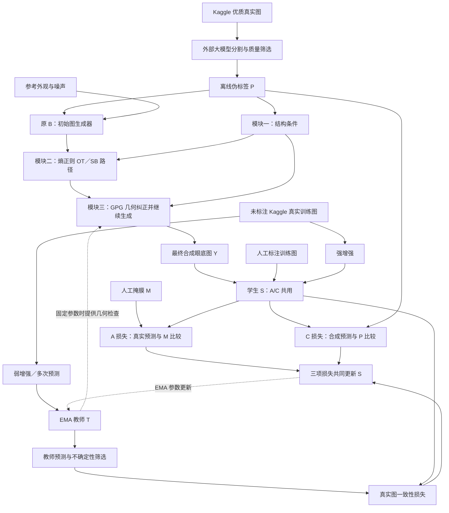
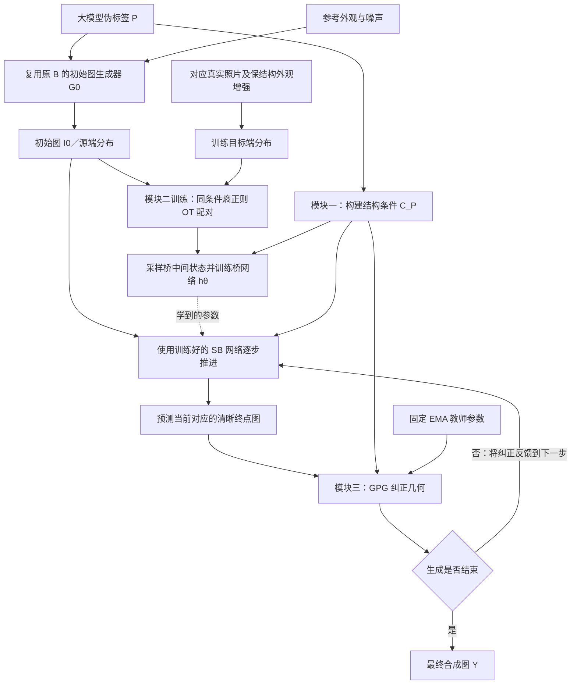

# GeoBridge-TS：几何引导桥生成与教师学生协同的眼底血管分割框架

- **框架名称：GeoBridge-TS。**
- **中文名称：几何引导桥生成与教师学生协同的眼底血管分割框架。**
- **英文全称／论文建议标题：GeoBridge-TS: Geometry-Guided Schrödinger Bridge Synthesis for Teacher–Student Retinal Vessel Segmentation。**
- **代码及实验标识：`geobridge_ts`。**

名称含义：**Geo** 表示血管几何条件与 GPG 结构纠正；**Bridge** 表示熵正则 OT／Schrödinger Bridge 生成路径；**TS** 表示 Teacher–Student，即学生与 EMA 教师协同学习。大模型伪标签驱动机制在方法介绍中展开。

GeoBridge-TS 是基于 MEDIA_CDARL 改造的新方案名称。下文统一使用 GeoBridge-TS 指代整套框架，MEDIA_CDARL 保留为原项目及复用代码来源。

- 更新日期：2026-11-19。
- 已确定：采用一个分割学生 S、一个 EMA 教师 T、一个生成器 B，以及生成训练所需的判别器 D。
- 本次修订：B 正式纳入三个模块——结构条件构建、熵正则 OT／Schrödinger Bridge（SB）生成路径、GPG 几何纠正；继续使用单学生、单 EMA 教师，不安排多组或多模型版本训练。
- 代码交接补充：第 12–18 节规定中转站分割 API、数据契约、数值参数化、文件接口、阶段命令和验收要求，可连同本文件交给另一个模型实施。
- 状态：研究与实施方案；当前仅更新文档，未修改训练代码、调用付费 API 或启动训练。

实施范围是一套系统：中转站离线分割 → 可靠伪标签 → 三模块 B → 单教师学生 A/C/U 训练。用户稍后提供请求地址、API key、模型名和提示词。实现者先完成配置、适配器和模拟响应检查，不擅自填入真实凭据、编造提示词或启动全量付费调用。方法见第 1–11 节，具体编码以第 12–18 节的接口约束为准。

## 1. 一句话说明

大模型为 Kaggle 图像产生伪标签；B 将其转换为几何条件，以原 B 的初始图为起点，通过熵正则 OT／SB 学习走向真实眼底图的生成路径，并由 GPG 在途中纠正血管结构。C 使用最终合成图与原伪标签训练学生；A 使用人工标注真实图训练同一个学生；EMA 教师同时提供真实图一致性监督和 B 生成时的几何检查。

最终只部署学生分割模型，输入真实眼底图，直接输出血管掩膜。

## 2. 模型分别是谁

| 模型或路径 | 输入与输出 | 作用 |
| --- | --- | --- |
| 外部大模型 | Kaggle 原图 → 候选血管伪标签 P | 离线提供血管条件，不参与本地反向传播 |
| B：完整生成器 | 结构条件构建＋原 B 初始图＋OT／SB 路径＋GPG → 合成图 Y | 提供结构受控的合成训练图；内部模块共同构成一个 B |
| A：学生的真实图分割路径 | 人工标注真实图 → 预测掩膜 | 预测与人工掩膜 M 比较 |
| C：同一个学生的合成图分割路径 | 合成图 Y → 预测掩膜 | 预测与输入 B 的 P 比较 |
| 教师 T | 真实图或预测的清晰合成图 → 概率图 | 为学生提供一致性监督；固定参数时为 GPG 提供可微几何检查 |
| 判别器 D | 真实图／合成图 → 真实性判断 | 主要辅助原 B 初始图生成器的外观训练 |

A、C 共用一个学生 S，不是两个独立分割模型。教师是 S 的 EMA 副本，不是 GPT，也不是 C。

## 3. 唯一的总体流程



图中三个生成模块与原 B 初始图生成器合起来才是完整 B。OT 使用真实照片形成训练目标分布；正式合成时不能访问待生成目标照片。B 的训练、SB 逐步采样与 GPG 如何衔接见第 5 节。

## 4. 数据在哪里使用

| 数据 | 使用位置 | 监督目标 |
| --- | --- | --- |
| 约 8k 张优质 Kaggle 图 X 及对应伪标签 P | 训练原 B 起点生成器、条件 OT 与 SB | X 提供真实图目标，P 固定血管结构；构造同条件的源端和目标端外观候选 |
| B 合成的图 Y | C，训练学生 | 输入 B 的同一份伪标签 P |
| 人工标注训练图 | A，训练学生 | 人工血管掩膜 M |
| 未标注 Kaggle 真实训练图 | 教师学生一致性分支 | EMA 教师的可靠预测 Q_T |
| 人工标注验证图 | 验证 | 选择检查点、阈值及设置，不更新参数 |
| 人工标注测试图 | 最终评估 | 不参与训练和调参 |

约 8k 张是 3 万张中的子集。首轮优先使用优质训练图，其余数据以后按质量扩充，不要求本次另跑一套模型。

40 张标注可考虑约 20 张训练、10 张验证、10 张测试，最终根据受试者和数据来源确定。只有训练部分用于 A 更新参数；验证、测试图也不能进入 B 的训练参考池或教师学生未标注训练池。

两种伪标签不能混淆：

- **P：外部大模型离线生成。** 用于 B 的结构输入和 C 的监督目标。
- **Q_T：EMA 教师在线预测。** 用于未标注真实图上的教师学生一致性。

本方案不要求用 Q_T 替换 P。

## 5. B 的正式设计：三个模块全部纳入

### 5.1 整体结构与论文迁移边界

`P → 结构条件 C_P；原 B 得到 I0 → 条件 OT／SB 生成路径 → GPG 逐步纠正 → Y`

三个模块均属于当前计划，不再只采用几何损失来代替第二模块。完整 B 内含一个初始图生成器 G0 和一个桥网络 hθ，不表示另建两套分割模型。

| 模块 | 用什么数据 | 学习或执行什么 |
| --- | --- | --- |
| 一：结构条件 | 伪标签 P | 固定算法计算几何；如有条件编码器，其参数随桥网络学习 |
| 二：熵正则 OT／SB | 同一 P 下的初始图候选与对应真实照片外观候选 | OT 求软配对；桥网络学习逐步生成 |
| 三：GPG | 当前预测图、P 和固定教师 T | 在线优化图像变量以纠正几何，不另训练一个教师或 GPG 网络 |

论文主要做冠脉造影的局部狭窄编辑；本任务做眼底血管条件合成。以下是针对本任务提出的数值实现方案，不声称逐项复现论文全部求解器，也不承诺迁移后保持其最优性或像素级精度。



OT 配对与桥训练使用真实 X；右侧逐步合成只使用 I0、结构条件、模型参数和随机噪声，不把未知目标 X 输入推理器。

### 5.2 模块一：将伪标签变成复合结构条件

论文使用的结构复合表示包含编辑掩膜、掩膜内图像边缘和边界。本任务采用：

`C_P = concat(P_binary, boundary(P), skeleton(P), signed_distance(P))`

| 通道 | 提供的信息 |
| --- | --- |
| 掩膜 | 血管占据的位置 |
| 边界 | 血管轮廓 |
| 骨架 | 中心线及分支结构 |
| 有符号距离图 | 内外关系、管径和边界距离 |

复用 `data/geometry.py`，几何增强后重新计算条件，保持 P、C_P、监督目标严格对齐。可加入图像级或像素级可靠度，但不能把大模型自报置信度直接当作校准概率。

这里不盲目加入另一张参考图的血管边缘，否则可能与目标 P 冲突。条件几何派生本身无需训练；如使用条件编码器，其参数随桥网络学习。

### 5.3 原 B 的用途：提供源端初始图

将原 B 的初步合成部分定义为 G0，生成 `I0 = G0(P, reference, noise)`。它不是最终完整 B 的替代品，而是 SB 的图像域起点。

G0 先用真实图—伪标签配对数据训练：

`L_G0 = λ_rec L_rec + λ_adv L_adv + 可保留的原扩散去噪项`

配对重建比较合成图与对应 X；D 提供真实外观监督。更新 D 时断开生成图与 G0 的梯度；更新 G0 时固定 D 参数、保留对图像的梯度。

G0 达到基本结构可控后固定，再训练桥网络，避免源端分布每一步变化。未核实的旧权重不作为已加载前提。原 R 仅可提供部分编码器设计或兼容权重，不能直接当作已经训练好的 SB。

### 5.4 模块二：明确 OT／SB 的起点、终点和条件

| 定义 | 本任务中的含义 |
| --- | --- |
| 条件 | 同一伪标签 P 的几何 C_P |
| 起点 x0 | G0 根据 P 产生的初始图 I0 |
| 训练终点 x1 | P 对应的真实照片 X，或其不改变几何的外观增强 |
| 源端分布 μ0 | 同一 P 下不同噪声、外观输入产生的 I0 候选 |
| 目标端分布 μ1 | 同一 P 对应照片的保结构外观候选 |
| 推理输出 | 从 x0 出发，经训练后的桥网络与 GPG 得到 Y |

起点和终点都在相同图像空间，通道、范围、分辨率统一；P 通过条件编码注入，不把四通道掩膜条件直接当作单通道图像端点。

**避免 OT 退化：** 若每个条件只有一张 I0 和一张 X，端点配对唯一，不能把这种固定配对当作有意义的 OT 匹配学习。计划在每个 P 内构造少量候选，例如 2 个初始图与 2 个目标外观候选，作为显存可校准的起点。目标外观增强仅改变合理范围内的照明、对比度等，不改变几何。它们不是额外独立真实病例。

每个 OT 小组必须保持同一 P 和坐标。不能任意把 P_i 与照片 X_j 做跨结构配对，再仍拿 P_i 训练 C。如果样本不足以构造有效候选，应如实记录退化，不能仅因使用 Sinkhorn 就声称获得了非平凡 OT 收益。

### 5.5 熵正则 OT 如何计算

同条件下，令源端候选为 x0_i、目标端候选为 x1_j，边缘权重 a、b 先采用均匀权重。采用统一规范化图像空间的二次代价：

`c_ij = ||x0_i − x1_j||² / 2`

求解：

`π* = argmin_{π≥0, π1=a, πᵀ1=b} sum(π_ij c_ij) + ε KL(π || a⊗b)`

- 使用 log-domain Sinkhorn 数值求解，保存边缘误差与迭代残差。
- π* 是候选配对的概率权重；按它采样端点对，不把所有真实照片加权平均成一张模糊目标图。
- ε 控制熵正则强度，需要与参考扩散尺度一致，而不是照搬论文数值。
- 如把平方和改成像素平均，需要同步标定代价与扩散尺度，避免因分辨率改变而悄悄改变问题。
- 此阶段先固定 G0，通过端点样本估计 π*；不默认需要对 Sinkhorn 反向传播训练 G0。

OT 的作用是定义符合端点分布的低代价软配对；它不是额外命名的普通 L1 损失。

### 5.6 SB 网络怎样训练

选用与上述二次代价和熵尺度匹配的布朗参考过程，时间范围为 [0,1]，参考扩散幅度为 `sqrt(ε)`。按 π* 采样 `(x0, x1)` 后，采样桥的中间状态：

`x_t = (1−t)x0 + t x1 + sqrt(ε t(1−t)) ξ，ξ ~ N(0,I)`

首版代码固定采用清晰终点预测参数化，不让实现者在多种输出定义之间自行混用：

`xhat1 = hθ(x_t, t, x0, C_P)`

`bθ = (xhat1 − x_t) / (1−t)`

`L_bridge = E[mean((xhat1 − x1)²)]`

这是条件布朗桥漂移回归 `E[(1−t)² mean((bθ − (x1−x_t)/(1−t))²)]` 的等价参数化。训练 t 避开精确端点，生成时再由终点预测换算漂移，减少末端目标尺度爆炸。网络输出的是清晰终点，不能把它直接当漂移或噪声预测。

条件端点分布、OT 软配对、布朗参考噪声及漂移回归共同组成这一数值 SB 近似。π* 的数值精度、候选覆盖和网络误差都影响结果，不声称有限样本训练已经精确求得无限维最优桥。

采样时可采用 Euler–Maruyama 推进：

`x_{k+1} = x_k + Δt bθ(x_k,t_k,x0,C_P) + sqrt(ε Δt) ξ_k`

临近终点时使用预测的清晰终点完成输出，避免直接计算 t=1 的奇异分母。推理不需要 x1；真实 x1 仅参与训练。

主训练目标使用 L_bridge，已经包含终点回归，不再重复叠加一项同样的终点 MSE 并声称是额外监督。不能把原 G0 的无条件去噪损失当作 L_bridge；首版不额外加入桥端对抗损失，以保持已定义的目标清楚。

### 5.7 模块三：GPG 怎样真正纠正生成过程

GPG 不只是反复输入 P，也不只是最终输出后计算一个分数。它要在若干生成步骤中实际修改预测状态，再将纠正反馈到后续生成。

为避免让教师分割纯噪声，先用当前桥网络估计清晰终点：

`xhat1 = x_t + (1−t) bθ`

固定教师 T 的参数，用 `T(xhat1)` 与 P 比较。定义投影式纠正目标：

`E_geo(y) = λ_mask L_mask(T(y), P) + λ_boundary L_boundary(T(y), P)`

`y* ≈ argmin_y E_geo(y) + λ_prox ||y − xhat1||²`

其中 mask 项可用可靠区域内的 BCE／Dice；boundary 项可用可微软边界与目标距离图构造。只对图像变量 y 做少量有界梯度更新，不更新教师；近端项限制为了提高分割分数而产生的极端图像变化。

将纠正反馈到漂移，再继续推进：

`b_guided = bθ + κ(t) (y* − xhat1) / max(1−t, δ)`

未执行 GPG 的步骤使用原 bθ；执行时使用 b_guided。κ(t) 与梯度步长渐增并有上限，避免过弱的初始教师或早期预测破坏整个生成过程。

执行要求：

- 教师参数固定，但 GPG 前向必须保留对输入图像的梯度，不能整个包在 no_grad 中。
- 每次图像纠正限制更新幅度，并投影回约定图像范围；只在有效视野内计算几何项，避免越界值或黑边主导优化。
- 不通过阈值化、NumPy 硬骨架等不可微操作计算待优化图像分支的梯度；P 的目标几何可以预计算。
- 先在可靠目标区域约束几何，不把不确定细支强行判成背景；教师误差不能作为真实血管证据。
- 投影式纠正只有有限迭代，是软近似，不能据此宣称严格满足全部硬几何约束。
- GPG 改变了原 SB 采样动力学，输出应称为几何引导的 SB 生成，不再直接声称保留未引导过程的精确 OT 最优性。

### 5.8 整图合成不照搬“血管外复制原图”

论文的编辑区域与血管掩膜不同。本任务默认编辑范围是有效眼底视野，视野内允许生成背景与血管；不将 `1−P` 直接当作严格保护区，否则会复制参考图旧血管。

如需外观稳定，可使用低频外观条件或较弱的低频损失；只有明确局部编辑、明确哪些区域不应改变时，才加入编辑区域外保护项。人工真值 M、目标血管 P 与编辑区域分别定义，不混用符号。

### 5.9 一次 B 训练与一次 B 合成

**训练 B：** 固定已预热的 G0 和几何检查教师，读取 `(X,P)`，构造同条件端点候选，求 π*，按配对采样 t 和 x_t，计算 L_bridge，更新桥网络 hθ。GPG 是生成中的投影式纠正，不要求每个桥训练 batch 展开全部生成步骤或对所有投影进行二阶反向传播。

**合成图：** 输入 P、参考外观和噪声，G0 得到 I0；桥网络逐步推进，按计划频率执行 GPG，输出 Y、原 P、条件及生成元数据，形成 C 的训练对。这里没有待生成目标 X。

先以论文的 50 个桥步、每 5 步一次 GPG 作为可调参考，而非已验证超参数；投影迭代数、ε、δ、κ 与显存耗时需在目标设备校准。单张图内部的多步生成不是多套模型或多组实验。

### 5.10 B 达到什么条件后供给 C

- 大模型输出、真实图和条件严格对齐，不能只有视觉上连续但坐标错误的掩膜。
- G0 在固定参考、替换 P 时具有基本结构控制能力。
- 桥网络在不输入目标照片的情况下可以完成生成，端点噪声与条件使用正常。
- GPG 确实改变图像并减少结构偏差，不能只提高教师分数却损坏外观。
- 最终图没有明显旧血管残留、目标血管缺失、异常光晕或细支变成灰带。

B 必须接受充分的生成训练，不能把“预热”理解为随机网络跑几步就可直接训练 C；当前训练预算需依据实际质量、验证与资源决定。

## 6. 学生和教师怎么训练

本节使用第 5 节完整 B 生成的最终 Y，不能用 G0 的初始图 I0 替代而仍称为经过三个模块的输出。P 始终保持为该 Y 的目标血管条件。

### 6.1 A：人工标注监督

`真实标注图 → S → 预测 → 与人工掩膜 M 比较`

`L_A = BCE + Dice`

A 提供可靠的真实域分割约束，减轻只学习合成图带来的偏差；它不直接修改合成图。

### 6.2 C：合成图监督

`合成图 Y → 同一个 S → 预测 → 与输入 B 的 P 比较`

`L_C = 可靠度加权的 BCE + Dice`

没有可靠像素置信度时，先采用样本质量筛选和较低合成监督权重，不编造置信度。有效区域内计算损失，避免把未知细血管直接当背景。

### 6.3 教师：真实图一致性监督

1. 对同一张未标注真实图，教师处理弱增强版本，学生处理强增强版本。
2. 对教师做多次弱增强预测，逆变换对齐后，计算平均概率和预测间差异等不确定性。
3. 根据不确定性和置信度选取可靠区域，监督学生预测与教师目标一致。
4. 教师目标与梯度断开；一致性损失只更新学生。
5. 学生更新后，教师通过 EMA 吸收学生参数。

若有翻转、旋转等几何变化，教师目标必须映射到学生坐标。需要同时检查前景和背景覆盖率，避免筛选后只剩背景和粗血管。教师预测稳定不代表一定正确。

`L_U = sum(V × R × BCE(p_S, stopgrad(Q_T_aligned))) / max(sum(V × R), 1)`

V 为有效视野及变换区域，R 为可靠区域。没有可靠像素时该项为零。

这里的教师前向可以关闭梯度，因为它只产生学生目标。第 5.7 节 GPG 使用同一个教师角色，但必须保留输入图像梯度；两种使用场景不能共用一个无条件 no_grad 包装。

### 6.4 一个总损失

`L_S = λ_A L_A + λ_C L_C + λ_U(t) L_U`

三个目标训练同一个学生：真实标注图分得准、合成图找回条件结构、未标注真实图增强后预测仍稳定。

λ_U(t) 从弱到强逐步增加，避免初期不可靠教师主导训练。人工标注样本持续采样，不因合成图数量多而失去作用。

### 6.5 EMA 更新

`θ_T ← α θ_T + (1−α) θ_S`

教师不通过分割损失反向传播更新。α 结合验证表现和更新频率确定，0.99–0.999 仅作为可校准起点。

教师保持评估状态。首版固定规则：可学习参数做 EMA，非参数缓冲状态从学生直接复制，包括归一化统计、计数与其他运行缓冲，不再对不同浮点缓冲任意选择平均方式。只在学生优化器真正更新后更新 EMA；梯度累积的微批次或 AMP 溢出跳步不更新 EMA 计数。恢复训练时恢复教师历史状态，不重新复制学生覆盖它。

## 7. 一套训练任务的阶段安排

下列是同一套系统的准备、预热与正式训练阶段，不是多组完整实验，不要求先训完一个无教师版本。

| 阶段 | 做什么 | 目的 |
| --- | --- | --- |
| 数据准备 | 确定划分、生成和筛选 P、计算 C_P、验证坐标 | 获得可靠结构条件与真实目标图 |
| 模块初始化与训练 | G0 用配对数据学习初始合成；S 用人工标注训练部分获得基本分割能力 | 得到可用源端与几何检查起点 |
| 教师初始化 | 从当前 S 复制得到 T | 建立唯一 EMA 教师，供 GPG 和一致性使用 |
| OT／SB 训练 | 固定 G0，构造同条件端点组，求熵正则 OT 配对，训练桥网络 hθ | 建立可运行的图像生成路径 |
| 完整 B 合成 | 暂时固定 T，SB 逐步生成并执行 GPG，保存最终 Y、P 与教师指纹 | 获得经过三个模块的 C 训练数据 |
| 正式分割训练 | 使用缓存 Y，B 不更新；S 接受 A、C、一致性三项监督，T 每步 EMA 更新 | 训练最终教师学生模型 |
| 验证与测试 | 验证集选择学生检查点，测试集做最终评估 | 判断本套模型的真实分割表现 |

学生初始化是在同一套系统中建立起点，不需要另做一套完整无教师模型。有兼容的有效权重时可迁移，但需核实来源和形状。G0 与桥网络需要各自充分训练，不能将它们的训练省略为几次接入检查。

首轮采用离线缓存最终合成图，避免正式分割训练中每个 batch 重跑完整 SB＋GPG。缓存生成时固定的是当时的 T，随后 T 的 EMA 更新不会改变已保存的 Y。

如以后确有必要刷新合成图，应在明确的阶段边界暂停学生更新、固定当前 T，重新生成并记录数据版本后恢复训练。不能一边声称 B 的数据供应固定，一边让在线 GPG 使用持续变化的教师而不记录。保存生成时 T 的检查点即可复现，不需要新增第二个常驻教师模型。

一次正式训练步骤：

1. 取人工标注图及 M，计算 A 损失。
2. 取完整 B 缓存的最终合成图及原 P，计算 C 损失；不反向更新 G0、桥网络或 GPG 图像优化过程。
3. 取未标注真实图，教师弱增强预测，学生强增强预测，计算不确定性筛选后的一致性损失。
4. 合并三项损失，反向更新学生 S。
5. 用更新后的学生参数对教师 T 做 EMA。

## 8. 参数共享与代码落地

原 C-DARL 的 B 与分割路径复用部分模块。若要固定 B、更新学生，需要明确拆分，不能让同一组参数既冻结又更新。

建议建立三个参数独立的实例：

- **G_B：生成实例。** 包含原 B 初始图生成器 G0、结构条件编码、时间条件桥网络 hθ、OT 配对与 GPG 接口。
- **S：分割实例。** A、C 共用；包含完整分割所需模块。
- **T：教师实例。** 仅复制 S，不复制独立 B 或判别器。

G0、桥网络 hθ、S、D 分别管理需要的优化器和训练阶段。OT 求解器按端点数据求配对；GPG 优化当前图像变量，不是给教师新增优化器。T 不设参数反向传播优化器，采用 EMA 更新。

正式分割训练中，B 固定，直接读取缓存 Y；教师产生一致性目标时可以关闭前向梯度。GPG 生成时则固定教师参数、保留对图像的梯度。沿用当前图像通道以复用基础结构，彩色扩展不能无声套用单通道权重。

原项目：`D:\program\CTA大模型_分割\分割图像——医学图像\MEDIA_CDARL`。

建议的代码落点如下，均为待实施规划：

| 位置 | 计划职责 |
| --- | --- |
| `data/geometry.py` | 复用 P 的边界、骨架和距离图，处理增强对齐 |
| 新配对数据与端点候选读取模块 | 管理 `(X,P)`、同条件候选、受试者划分与可靠度 |
| `model/ddpm_modules/diffusion_seg.py` | 保留 G0 的原合成入口，另提供完整 B 的统一调用，区分初始图与最终图 |
| 新 `model/ot_bridge/transport.py` | 同条件代价矩阵、log-domain Sinkhorn、边缘残差与配对采样 |
| 新 `model/ot_bridge/bridge.py` | 清晰终点预测网络、桥状态采样、L_bridge、漂移换算与参考扩散 |
| 新 `model/ot_bridge/gpg.py` | 冻结教师、清晰终点估计、可微几何目标与投影式纠正 |
| `model/refinement.py` | 仅将可兼容部分作为桥网络骨干参考；原三步残差更新不能冒充 SB |
| 训练入口及配置 | G0 训练、SB 训练、GPG 合成缓存、A/C/U 训练与 EMA 阶段管理 |
| 保存／评估模块 | 分别记录 OT、SB、GPG、学生、教师状态与数据版本 |

复用原判别器和预处理；新增模块不等于直接复用论文官方代码。论文中未充分展开的求解细节按本方案实现并验证，不能预写为已复现成功。

## 9. 本套模型怎样评估

当前只执行上述一套教师学生方案，不安排多个编号组别或另训一个无教师模型。

训练中用独立验证集选择学生检查点和必要阈值，最终用独立真实标注测试集报告 Dice、Precision、Recall、PR-AUC 和连接性。测试样本不参与训练及调参。

记录 A/C/U 原始及加权损失、教师可靠区域覆盖率、前景／背景比例，以及学生验证指标。B 记录 G0 重建与对抗损失、L_bridge、OT 边缘残差与配对熵、端点噪声设置、GPG 前后结构误差、图像变化幅度、生成耗时与显存。

必要的实现验证包含：同条件配对没有错配标签；ε 与参考噪声标定一致；桥推理不读目标照片；GPG 图像梯度非零而教师参数不变；生成缓存可追溯到 G0、桥、教师和 P 的版本。它们是本套模型的正确性检查，不是要求额外训练多组完整模型。

内部循环分数和教师一致性分数不能替代真实标注评估。仅完成本套模型，可以报告其性能；若将来要证明某模块带来了提升，再按论文需要单独设计对照，不作为当前执行前置条件。

## 10. 保存与最终使用

保存 G0、桥网络、学生及教师完整状态，相关优化器、调度器、阶段、EMA 步数、数据划分和随机状态；记录 ε、代价规范化、Sinkhorn 设置、桥步数、GPG 频率／步长／纠正权重、生成时教师检查点和伪标签指纹。合成缓存清单同时记录每张 Y 对应的 P、参考图、种子和完整 B 版本。

最终部署：

`新的真实眼底图 → 学生 S → 血管概率图／二值掩膜`

B、判别器、EMA 教师和外部大模型均不必参与最终推理。

## 11. 方法依据

分割端使用 Mean Teacher 的 EMA 机制，借鉴 UA-MT 的不确定性感知监督，并采用弱增强—强增强一致性进行眼底任务适配。

生成端正式纳入 OT-Bridge Editor 的三个模块思想。本方案具体采用同条件候选的熵正则 OT、匹配布朗参考的 SB 数值近似，以及清晰终点上的 GPG 投影式纠正；这是眼底条件合成的适配设计，不声称逐项直接复现原论文或证明其严格几何可行性。

用户提供论文：`D:\baidu_wangpan\BaiduNetdiskDownload\cta分割和3d影像\CTA分割\20_2026_OT_Bridge_Editor_ICML_ARCADE.pdf`。主要依据第 3 节、图 2／图 3、式 (1)–(10) 及附录 A（PDF 第 3–5、13–15 页）。其中图像—分割掩膜配对训练见附录 A；同条件候选构造、漂移回归参数化和清晰终点 GPG 是本方案为工程落地补充的具体设计，不作为原文已有结论。

- [Mean Teacher](https://arxiv.org/abs/1703.01780)
- [UA-MT](https://arxiv.org/abs/1907.07034)
- [UniMatch](https://arxiv.org/abs/2208.09910)

## 12. 中转站大模型分割代码：必须实现

### 12.1 已知输入与待提供信息

用户使用中转站：提供请求地址、API key、模型名，将眼底图发给模型进行分割；提示词由用户另行提供。代码必须支持这个流程，不要求用户改用官方 OpenAI 服务。

目前尚不知道中转站的请求协议、图像输入方式、真实响应结构及掩膜返回能力。实现时把传输协议和掩膜解析拆成适配器，不能根据模型名猜测它支持什么，也不能假定所有接口都返回 PNG。

用户未提供真实值之前，可以完成所有离线代码、配置校验、模拟响应与测试。真实 API 请求仅在配置完整并显式执行对应命令时发生，不能在导入模块、启动训练或自动测试时发生。

### 12.2 配置与提示词约定

提供配置示例、字段说明，以及不含秘密的环境变量模板。API key 从环境变量或本机忽略提交的环境文件读取；不能写进源代码、公开配置、命令日志或检查点。

下面只是配置结构示例，空值由用户补齐；协议需以实际中转站为准：

```json
{
  "gateway": {
    "request_url_env": "FUNDUS_API_URL",
    "api_key_env": "FUNDUS_API_KEY",
    "protocol": "openai_chat_completions",
    "model": null,
    "auth_header": "Authorization",
    "auth_prefix": "Bearer ",
    "prompt_file": "prompts/vessel_segmentation.user.txt",
    "response_profile": null,
    "connect_timeout_seconds": 10,
    "read_timeout_seconds": 180,
    "max_attempts": 3,
    "concurrency": 1,
    "requests_per_minute": null,
    "max_requests": null,
    "retry_ambiguous": false
  }
}
```

- 请求地址按用户提供的完整 URL 使用，不自行重复拼接 `/v1` 或 `/chat/completions`。
- 至少预留 `openai_chat_completions`、`openai_responses`、`custom_json` 适配接口。实际选用一个；未提供自定义字段映射的 custom 协议应明确报配置缺失。
- 图像默认可由适配器编码成正确 MIME 的 base64 data URL；若服务要求上传文件或其他形式，由对应适配器实现，不能硬套同一种请求体。
- 用户提示词按文件内容读取，UTF-8 保存，记录哈希；文件不存在、为空或仍是占位符时停止真实请求。不要自行编造医学提示词，也不静默重写用户内容。
- 模型特有参数放到受控的 `extra_body`；不允许无声覆盖已经确定的模型、图像、提示词和认证字段。
- 限流和总请求上限是运行参数。批量调用前必须设置有限上限，不把约 8k 张数据直接当作自动执行默认值。
- 连接、超时、并发等示例值是工程起点，不代表该中转站已经通过验证。

### 12.3 请求前准备与坐标保留

1. 用清单中的 sample_id 关联图像，读取原尺寸、MIME、哈希和 EXIF 方向。
2. 先建立统一方向的原图坐标，再进行服务所需的压缩或缩放，保存完整变换和请求画布尺寸。
3. API 默认接收 RGB 全视野图，独立于本地训练的灰度转换。不要为了适配本地 384 输入而自动把 API 请求也压成 384。
4. 请求尺寸、字节限制由已验证的模型能力决定；超限时明确提示或按配置转换，不悄悄裁掉细血管。
5. 首版使用完整图单次请求。若以后启用分块，必须另实现坐标拼接和边界重叠规则，不能把任意局部掩膜直接当整图标签。

### 12.4 响应解析：HTTP 成功不等于获得掩膜

统一返回 `ParsedSegmentationResult`，至少包含 sample_id、请求 ID、原始响应类型、掩膜或概率图、坐标信息、解析状态、失败原因与产物路径。

| 服务实际返回 | 代码应如何处理 |
| --- | --- |
| base64 编码的掩膜图 | 按已声明字段解码为本地图像，检查格式、尺寸和极性 |
| 掩膜下载 URL／文件引用 | 由已配置适配器取回产物，设置超时与大小上限；不得把中转站认证头无条件转发到其他下载主机 |
| JSON RLE／多边形／像素数组 | 按明确的编码、坐标和尺寸解码；COCO RLE 注意列优先约定，不能自行猜测 |
| 模型原生工具／内容块 | 按协议读取规定字段，保存真正的分割产物 |
| 只有解释文字或一句“分割完成” | 标记 `text_only_unusable`，不写出假掩膜 |
| 图片叠加图、截图、格式未知或坐标不明 | 标记待核查／不支持，不自动把它当黑白标签 |

必须先用实际单张响应确定 response_profile，再批量执行。live probe 在请求协议、凭据和提示词齐备时允许 response_profile 暂未确定，用于保存响应并识别能力；此时结果不能自动进入 accepted。批量 api-segment 必须固定已验证的 profile。解析器可识别已支持类型，但不能递归扫描任意字符串、找到一张图片就宣称分割成功。不得执行模型返回的 Python、Shell 或其他代码来“获取掩膜”。

输出掩膜约定为单通道无损 PNG，背景 0、血管 255；若实际极性不同，要通过显式配置转换并记录。原始概率图若存在另存浮点文件；模型自报置信度不得冒充像素概率。

返回画布与请求画布不一致时，只有明确的坐标映射才能恢复原图坐标。可对二值掩膜做已知变换下的最近邻映射，但不能靠任意拉伸或自动配准掩盖位置偏移。

### 12.5 输出质量检查与入库

检查可解码性、尺寸、坐标、像素范围、极性、有效视野和明显空白／全前景异常；异常进入待核查队列。前景比例和连通分量等阈值可配置，不把“自动通过”称为医学准确。

保留原始候选掩膜，默认不做自动补线、闭运算、删支或平滑来伪造连续性。形态学派生用于几何条件，不静默覆盖 P。

请求状态、解析状态与训练准入分开：`HTTP成功 → 产物解析 → 质量检查 → accepted／rejected／needs_review`。仅 accepted 的伪标签进入 B 和 C 的训练清单。

### 12.6 批量任务、重试与续跑

- 建议 SQLite 任务账本管理并发状态，JSONL 导出训练清单；不要多个 worker 无锁改同一个 JSON 文件。
- 任务键至少由原图／请求图哈希、提示词哈希、模型、协议、response_profile、预处理版本、影响生成的请求体参数及服务命名空间组成。相同有效任务结果直接复用，不能每次续跑都重新付费。
- 状态至少区分 pending、inflight、received、decoded、accepted、needs_review、failed、ambiguous。请求已发出但崩溃或超时、无法确定是否完成时进入 ambiguous，不当成从未调用。
- 明确的 429、临时服务错误和可重试网络失败采用有上限的指数退避与抖动，支持 Retry-After。401／403、请求参数错误及不支持的接口优先停止并报告配置问题。
- 若中转站支持幂等键，使用稳定任务键。若不支持，读超时后的重发可能重复计费；默认不自动重发 ambiguous，提供显式重试选项，不承诺跨崩溃严格只计费一次。
- 使用临时文件加原子替换写产物；恢复时核验已保存文件和哈希，不能只看“存在同名文件”。
- 记录返回的 usage、耗时、请求 ID 和重试次数。费用仅在服务返回或配置了计价依据时估算，缺失时写未知。
- 日志不打印 key、认证头、完整 base64 请求及带凭据的 URL；脱敏响应元数据与二进制产物分开保存。

### 12.7 阶段命令

实现 `api-probe`、`api-segment`、`pseudo-qc` 三个入口：

- `api-probe --dry-run`：只校验配置、提示词和请求结构，不联网。
- `api-probe --live --limit 1`：配置完整后，调用一张图，保存脱敏响应及可视化叠加供核查。
- `api-segment --limit N --resume`：固定已验证协议和响应类型，按任务账本批量处理。
- `pseudo-qc`：不重新请求 API，只检查已有产物并导出 accepted 清单。

这些是拟实现命令，不是当前仓库已经能运行的命令。尚无响应样例时，先实现模拟响应测试和适配器接口，不虚构已连通结果。

## 13. 统一数据契约与目录

### 13.1 清单是唯一配对依据

采用明确的 JSONL manifest，不按文件排序、取模索引或随机抽取来拼“真实图—伪标签”配对。路径可相对 manifest 所在数据根目录，读取后统一解析，不依赖当前 shell 目录。

| 数据类型 | 必需字段 |
| --- | --- |
| 所有样本 | sample_id、subject_id、split、image_path、image_sha256、原图尺寸、coordinate_frame |
| 大模型伪标签 | pseudo_mask_path、pseudo_status、pseudo_version、prompt_sha256、model、request_job_key、变换文件 |
| 人工标注 | gt_mask_path、标注来源、split；不能只根据“有没有 mask”猜测训练用途 |
| OT 端点 | condition_id、P 哈希、G0 指纹、源／目标候选 ID、外观增强和噪声种子 |
| 合成样本 | synthetic_id、Y 路径、目标 P 路径、来源 sample_id、参考图 ID、完整生成配置与模型指纹 |

API 请求账本与训练 manifest 分开。accepted 训练 manifest 固定版本；改变提示词、模型或预处理后输出新版本，不悄悄覆盖旧 P。

subject_id 优先来自可靠映射；若只能按文件名识别双眼，记录这一限制并核实。初始化时检查受试者和图像哈希跨划分重叠。训练、验证、测试标签和图像的用途严格分离。

### 13.2 张量约定

| 名称 | 形状／范围 | 备注 |
| --- | --- | --- |
| 本地图像 X、I0、Y | float32 `[B,1,H,W]`，通常在 [-1,1] | 首版与当前单通道模型一致，API 输入仍为 RGB |
| 掩膜 P、M | float32 `[B,1,H,W]`，0/1 | 文件为 0/255；进入损失前归一化 |
| 几何 C_P | float32 `[B,4,H,W]` | 前三通道 0/1，距离图 [-1,1] |
| 有效视野 V | `[B,1,H,W]`，0/1 | 不等于血管掩膜 |
| 标签有效性／权重 W_label | `[B,1,H,W]`，非负 | 未知标签权重为零；没有概率时使用明确的统一权重 |
| 教师概率 Q_T、学生概率 p_S | `[B,1,H,W]`，0–1 | 与 logits 严格区分 |
| 桥时间 t | `[B]`，0≤t<1 | 与原扩散离散时间、GPG 迭代序号分开 |

首版本地全视野尺寸可用 384×384 作为显存校准起点；API 分辨率独立配置。保持长宽比、裁边／填充与缩放矩阵一致，不能给图像和对应掩膜各做一次独立随机裁剪。薄血管缩放损失需要在验证中检查，不能假设尺寸越小标签仍完全保真。

外观增强不改变几何时 P 不变；几何增强后同步变换图像、P、M、V、权重，再重新计算 C_P。

### 13.3 运行目录

统一使用 `runs/geobridge_ts/<run_id>/`，保存脱敏配置、manifest 快照、API 任务账本、伪标签版本、OT 诊断、检查点、合成缓存、日志和评估结果。源数据只读，真实凭据不进入运行快照。

## 14. 关键模型接口与数值实现约束

### 14.1 可微分割核心

新增统一的 `SegmentationCore.forward_probability(image)`，A、C、教师一致性和 GPG 均使用同一数学前向。该方法不能带 no_grad 装饰器，梯度是否开启由调用方决定。

首版可复用原去噪特征网络与 Gs，在 t=0 提取特征，拼接图像与特征后分割。若原输出为 [-1,1]，统一转换为 `p=(output+1)/2`；BCE 使用概率版，或显式转换为数值稳定的 logits 后用 BCEWithLogitsLoss，不能把概率误当 logits。

当前 `GaussianDiffusion.segment()` 已带 `@torch.no_grad()`，不能直接拿它作为 GPG 的可微接口；`tensor2img`、PIL／NumPy 转换和硬阈值也不能出现在这条梯度路径上。可视化与训练前向分开。

### 14.2 桥网络输出与架构

固定接口：`predict_endpoint(x_t, t, x0, geometry) -> xhat1`。

空间输入为 x_t、x0、C_P，共 6 通道；t 使用独立时间嵌入。输出 1 通道清晰终点，范围与目标 X 一致。使用条件 U-Net，初始可设基础通道 32、通道倍率 [1,2,4,4]、GroupNorm、时间嵌入和跳跃连接；几何在多尺度注入。最终参数量、输入输出和显存需记录。

可复用原 R 的部分设计，但首层、时间条件和输出含义已变化，必须明确迁移报告，不能用 strict=False 静默跳过后声称完整加载。原三步细化输出不能直接充当 SB 采样。

### 14.3 OT 与扩散尺度必须统一

首版配置将 `bridge.reference_variance = ε` 定义为每坐标、单位时间的布朗方差；OT 使用 `0.5 × sum((x0−x1)²)`，熵系数同为 ε，桥状态噪声与 SDE 噪声分别使用第 5 节公式。

如果为数值显示采用 `mean` 代价，设 d 为使用的坐标数量，则 OT 熵系数同步改成 `ε/d`，保持 `cost/epsilon` 不变；不能只改代价归约而继续使用原熵系数。首版求和包含统一画布全部坐标，几何损失另用 V；不引入未说明的像素度量变化。

代价与 log-Sinkhorn 优先用 float64；每个 P 内候选至少 2×2，不能跨 P 自由配对。检查 π 非负、总质量、两侧边缘残差和熵；不收敛时记录失败并按配置提高迭代或停止，不能无声改成均匀配对或任意取最近图。

端点重建目标为采样得到的真实候选 x1，不是 π 加权平均图。Sinkhorn 与采样本身不必反传到已固定 G0。

### 14.4 SB 与 GPG 的具体采样顺序

1. 时间网格从 0 推进至 `1−δ`，δ>0；网格与随机种子记录。
2. 桥网络在 no_grad 下预测清晰终点 xhat1，再用第 5 节公式计算漂移。
3. 到达 GPG 调度点时，用 `xhat1.detach().clone().requires_grad_(True)` 建立独立图像变量；在 enable_grad 中通过固定 T 计算几何目标并做有界纠正。
4. 得到 y* 后与图像优化图断开，计算 b_guided，推进下一 SDE 步；不保留整段历史图，不意外形成二阶梯度。
5. 末端显式输出一次清晰预测，并执行最终几何检查／纠正；不把仍带噪的 x_t 直接保存成最终 Y。

外层不能用一个 `torch.inference_mode()` 包住整个 B 合成流程，使 GPG 无法恢复输入梯度。桥预测的 no_grad 与 GPG 的 enable_grad 必须分区。

λ_prox 必须为正，梯度步长、迭代数与 κ 有明确上限，纠正后限制到合法图像范围。每幅图记录 GPG 前后几何误差和变化幅度；无有效区域则跳过，不能除零。

### 14.5 不确定性与 EMA

首版用多次弱增强预测估计不确定性，不依赖 MC Dropout；当前配置 dropout=0，不能直接重复确定性前向后把零方差当高可靠度。

不同弱增强预测先回到同一坐标、取共同有效区域，再计算平均与差异。学生强增强先采用不破坏血管可见性的外观增强；引入几何增强必须带变换矩阵和有效区域，不默认使用会遮住血管却仍强求原标签的操作。

S 与 T 参数和缓冲不共享内存。先完成真正的学生优化器更新，再 EMA 可学习参数、复制缓冲。教师无 optimizer，保持 eval；保存与恢复包含 T，而不是仅保存 S。

### 14.6 损失与旧逻辑隔离

- BCE、Dice、L_U 在有效区域内按样本／像素归一化；权重全零时该样本损失为零。Dice 的权重用于分子和分母，避免只屏蔽一边。
- 三类 batch 可先分别反向累积，再对学生执行一次 optimizer.step，随后 EMA 一次，减少同时保留多路图的显存。
- G0、桥、S、T 参数集合明确独立，构建优化器时检查参数 ID 和张量存储不交叠；A/C 必须使用同一 S 实例。
- 原 `MaskPatchNCELoss` 的预测特征被 detach，不能当作本方案结构监督。首版新流程默认不叠加原 NCE 或旧 appearance 项，不修改其原模式行为。
- 原无配对逐位置感知损失不自动恢复；本方案的配对重建只使用对应 X。额外机制不由实现者自行加入。

### 14.7 配置完整性与初始值

配置 schema 区分“工程默认”“待标定研究参数”“用户必填”，而不是把所有空项补成 0。可以先采用以下明确的工程起点，均不声称最优：

| 参数 | 首版约定 |
| --- | --- |
| 图像通道、训练画布 | 单通道，384×384，可在统一配置中调整 |
| 每类训练 batch | 1，按 A/C/U 分别累积梯度后更新一次学生 |
| OT 候选数 | 每个 P 至少 2 个源候选、2 个目标候选 |
| 桥输出 | 清晰终点预测，不允许隐式切换为噪声或漂移头 |
| 桥步数、GPG 频率 | 50 步、每 5 步一次，并执行末端纠正 |
| 时间端点 δ | 可从 1e-3 起步，训练和推理统一 |
| 教师弱增强次数 | 3 次，先对齐再估计差异 |
| EMA 系数 | 可从 0.99 起步，记录真实 optimizer 更新次数 |
| 学生损失权重 | 可从 λ_A=1、λ_C=0.5、λ_U_max=0.1 起步，一致性渐增长度显式配置 |

各阶段学习率、max_steps、设备、ε、Sinkhorn 容差与迭代上限、GPG 步长／投影次数／近端权重／κ 上限、不确定性阈值及有效像素策略都必须在示例配置中列出。不能确定的项可标为必填并在阶段开始前校验；为离线 smoke-run 提供独立小规模配置，不替用户编造正式训练预算。

缺少真实 API 配置只阻止 API 阶段；已有合格 manifest 时，本地训练不应强制要求 API key。反之，缺少对应模型检查点不能绕过依赖直接生成最终 Y。

## 15. 建议代码文件与职责

以下是拟新增或改造位置，实现者可按项目规范调整名称，但不能遗漏功能。原项目位置见第 8 节，保留原训练模式和配置。

| 文件／模块 | 职责 |
| --- | --- |
| `config/geobridge_ts.example.json` | 本套系统配置、必需字段验证、参数范围与各阶段路径 |
| `config/gateway_segmentation.example.json` | 中转站配置，只有环境变量名和提示词路径 |
| `.env.example`、`.gitignore` | 空凭据模板，忽略本机凭据文件 |
| `prompts/README.md` | 说明用户放置提示词的位置，不代写实际提示词 |
| `pseudo_labels/gateway.py` | 请求适配器、认证、限流、超时、重试、服务错误分类 |
| `pseudo_labels/parsers.py` | 图片／链接／结构化掩膜解析与严格坐标检查 |
| `pseudo_labels/jobs.py` | SQLite 账本、稳定任务键、断点续跑和不确定状态 |
| `pseudo_labels/quality.py` | 产物格式与质量检查、accepted 清单、可视化 |
| `data/fundus_manifest.py` | 全部数据契约、划分检查及文件哈希 |
| `data/paired_pseudo.py` | `(X,P)`、原图变换、可靠区域和同条件 OT 候选 |
| `data/synthetic_pairs.py` | 缓存 Y 与原 P 的严格对应 |
| `model/segmentation_core.py` | 共用的可微分割前向和输出范围适配 |
| `model/ema_teacher.py` | 复制、EMA、缓冲同步、不确定性目标 |
| `model/ot_bridge/transport.py` | 熵正则 OT 求解、边缘诊断与配对采样 |
| `model/ot_bridge/bridge.py` | 终点预测网络、桥状态与训练目标、SDE 推进 |
| `model/ot_bridge/gpg.py` | 固定教师对图像的可微纠正 |
| `training/stages.py` | G0、学生初始化、SB、缓存合成、A/C/U 的状态机 |
| `scripts/pipeline.py` | 配置驱动的阶段入口、resume、dry-run、smoke-run |
| `scripts/evaluate_student.py` | 学生真实图推理、回原图坐标、独立指标 |
| `tests/`、`IMPLEMENTATION.md` | 有针对性的离线验收、真实命令和已知限制 |

关键接口至少包含：`GatewayClient.segment()`、`parse_response()`、`build_geometry()`、`solve_conditional_ot()`、`predict_endpoint()`、`gpg_correct()`、`SegmentationCore.forward_probability()`、`update_ema()`。为每个接口定义参数形状、返回值、异常及是否允许梯度。

## 16. 单一流程的可执行阶段

这是一套系统的阶段，不是重新引入多个对照组。命令名称为规划示例，编码完成前不得称为现成入口：

```text
python scripts/pipeline.py api-probe --config <gateway_config> --dry-run
python scripts/pipeline.py api-probe --config <gateway_config> --live --limit 1
python scripts/pipeline.py api-segment --config <gateway_config> --manifest <train_manifest> --limit <N> --resume
python scripts/pipeline.py pseudo-qc --config <pipeline_config>
python scripts/pipeline.py prepare-data --config <pipeline_config>
python scripts/pipeline.py train-g0 --config <pipeline_config>
python scripts/pipeline.py warmup-student --config <pipeline_config>
python scripts/pipeline.py init-teacher --config <pipeline_config>
python scripts/pipeline.py train-bridge --config <pipeline_config>
python scripts/pipeline.py synthesize-cache --config <pipeline_config>
python scripts/pipeline.py train-student-teacher --config <pipeline_config>
python scripts/evaluate_student.py --config <pipeline_config> --split test
```

- 每阶段检查依赖产物、版本指纹和配置，不满足就明确报缺少什么，不能用随机网络、空掩膜或旧缓存顶替。
- 每阶段支持 resume；完成的 API 调用和有效合成缓存默认复用。新阶段的数据版本不符时不强行恢复旧优化器。
- `--smoke-run` 使用少量本地数据或明确的模拟数据，验证代码路径，不自动联网。CPU 小尺寸仅作功能验证，不作为真实效果结果。
- 正式 max_steps、显存预算与设备由配置明确给出，先实测吞吐再估算训练时长。不继承旧配置 20k 步就宣称新系统会收敛。
- G0／SB 充分训练、合成缓存完成后，正式分割阶段才读取 C 数据；缓存教师指纹固定，后续 EMA 不改写已经生成的 Y。
- checkpoint 保存阶段、步数、优化器、调度器、AMP、随机状态、采样器状态以及所有模型与数据指纹；若无法精确恢复多进程预取状态，明确保证范围，不能无证据承诺逐位复现。

## 17. 交付与验收要求

这些是功能正确性检查，不要求额外训练多个完整模型。用离线模拟和小网络完成大部分验证：

1. **中转站请求：** 模拟服务核对 URL、认证、模型、图像 MIME 和用户提示词，不访问真实收费端点。
2. **解析：** 覆盖至少一种实际支持格式及其响应 fixture；同时验证纯文字、叠加图、错误尺寸、错误极性和损坏文件不会进入训练。
3. **续跑：** 成功任务不重复发请求；429 退避有上限；崩溃后的 inflight 可进入 ambiguous；无幂等支持时不承诺超时重发免费。
4. **日志：** 使用虚拟密钥检查日志、配置快照与检查点中没有秘密值。
5. **坐标和划分：** 用非对称图案检查缩放、翻转和 RLE 顺序；同受试者及重复图跨划分报错。
6. **配对：** Y 的目标始终是输入 B 的 P；OT 不跨 condition_id；不再沿用原随机分形取模配对。
7. **OT：** 小代价矩阵求解后的边缘满足容差；ε／代价缩放等价；不收敛有显式状态。
8. **桥：** 终点参数化与漂移公式一致，时间避开奇异点；推理函数签名没有目标照片 x1；噪声方差与约定一致。
9. **GPG：** 图像梯度非零、教师参数不变；受控例子中纠正目标下降；不能调用被 no_grad 包装的分割接口。
10. **A/C/U：** 三类损失更新同一学生；T、G0、桥不被学生 optimizer 修改；EMA 只在真实学生更新后执行。
11. **保存恢复：** 小网络中断恢复后，阶段、学生、教师、桥及生成种子恢复正确；缓存清单可追溯。
12. **完整小流程：** 模拟 API 产物贯通到几何、G0、OT／SB、GPG、缓存、一次 A/C/U 更新和真实图形状的推理；模拟产物必须标记，不能混入正式数据。

交付时给出：实际新增／修改文件、依赖安装说明、配置字段表、真实可运行命令、测试结果、各阶段尚缺的用户输入和没有验证的环节。不能用“测试通过”替代真实生成或分割效果结论。

## 18. 交给编码模型的范围与缺失输入

### 18.1 用户稍后提供的内容

| 内容 | 缺失时如何处理 |
| --- | --- |
| 中转站完整请求地址、API key、模型名 | 配置与环境变量留空；离线实现继续，不发真实请求 |
| 提示词原文 | 由用户放入 prompt_file；不代写或硬编码默认医学提示词 |
| 实际协议文档或单次响应结构 | 用适配器与模拟响应开发；真实 probe 后固定解析 profile，再批量处理 |
| Kaggle 原图、优质子集清单、40 张图与标注路径 | 用 manifest 配置，不硬编码猜测实际训练路径 |
| 受试者映射及最终划分 | 提供可复现划分工具与重叠检查；示例 20/10/10 不当成已确认划分 |
| 可用兼容权重、GPU 和训练预算 | 明确加载检查；无权重不声称迁移成功，无设备数据不承诺耗时 |

### 18.2 可直接转交的实施说明

请在 MEDIA_CDARL 项目中实现本文件所述的 GeoBridge-TS 框架，包含中转站批量分割、结构条件、熵正则 OT／SB、GPG、单学生与单 EMA 教师，以及 A/C/U 训练。新增配置与实验标识统一使用 `geobridge_ts`。先核实仓库实际接口，按第 12–17 节完成可配置代码和离线验收，保留旧训练方式。

大模型伪标签 P 固定承担 B 的条件与 C 的监督；人工 M 监督 A；教师 Q_T 监督未标注真实图，并在缓存生成阶段固定用于 GPG。不要替换这些答案来源，不新增多教师、多学生或多组完整实验。不要把现有 R 改个名字当 SB，不把文字回复当掩膜，不在测试中调用付费 API。

用户尚未提供的地址、密钥、模型和提示词做成显式配置缺项。先交付可审查的代码、模拟测试和运行说明；真实 API 验证及长训只有在配置具备后通过对应命令启动。所有实现状态如实记录，不预写已经生成 8k 掩膜或已经训练成功。
